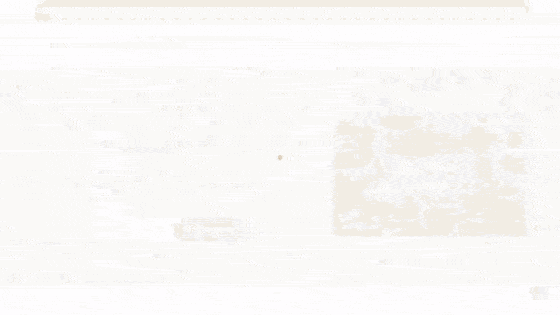
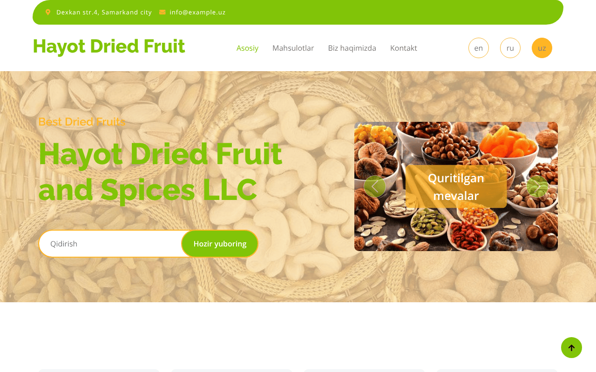
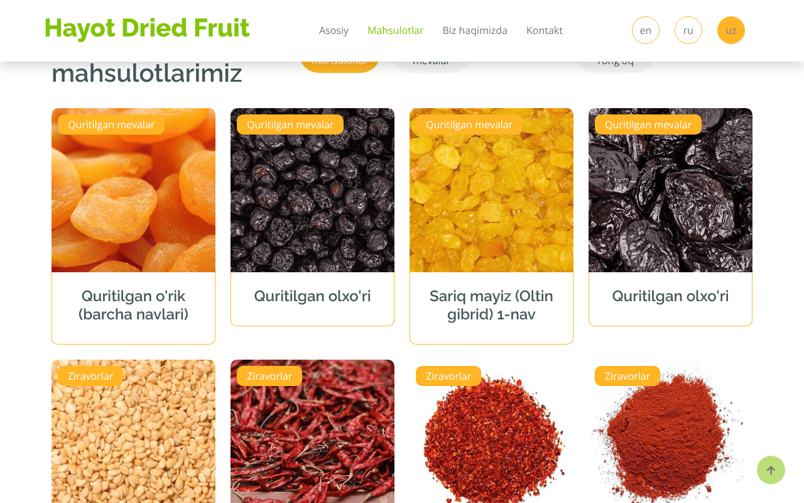
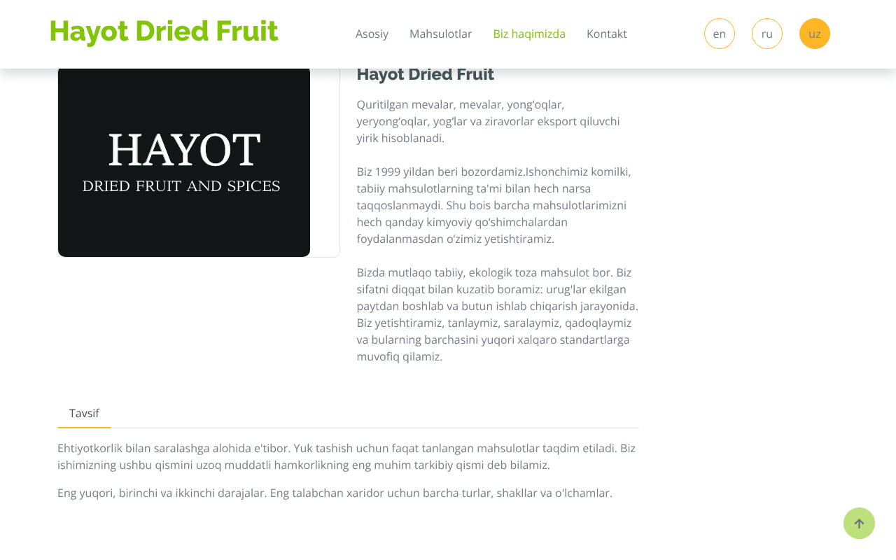
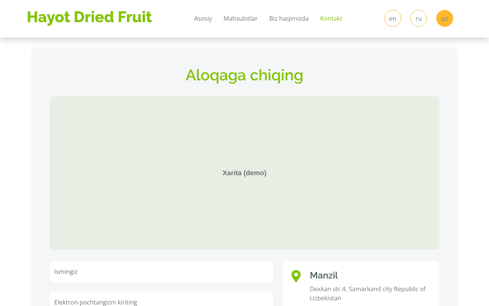
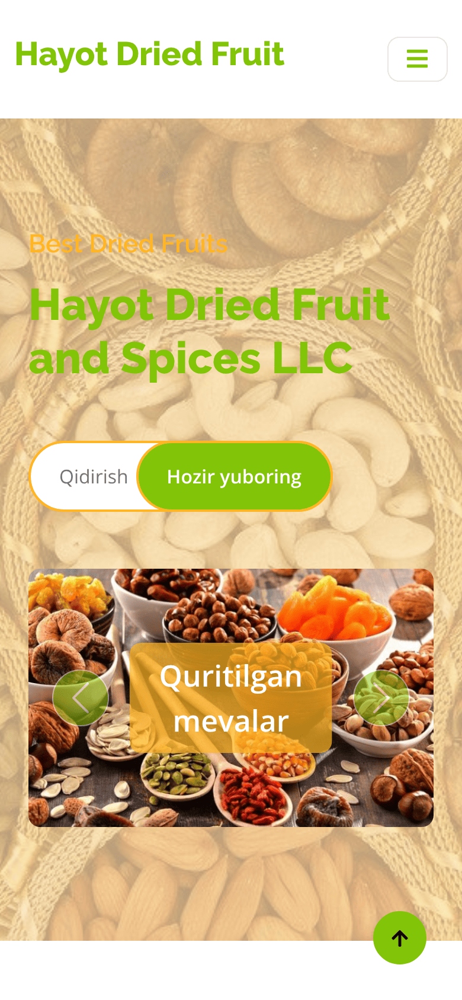
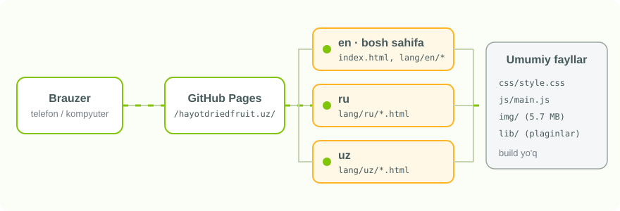

<div align="center">

# Hayot Dried Fruit

Quritilgan meva va ziravor eksport qiluvchi kompaniya uchun uch tilli (en · ru · uz) statik tanishtiruv sayti.


[Jonli sayt](https://abduazizbobomalikovnode.github.io/hayotdriedfruit.uz/) ·
[Ko'rinish](#korinish) ·
[Qanday ishlaydi](#qanday-ishlaydi) ·
[Ishga tushirish](#ishga-tushirish) ·
[Cheklovlar](#xavfsizlik-va-cheklovlar) ·
[Optimizatsiya](#optimizatsiya-oldin-va-keyin)



</div>

> [!NOTE]
> Screenshot va GIF'larda e-pochta va telefon raqamlari demo qiymatlarga (`info@example.uz`, `+998 00 000 00 00`) almashtirilgan. Xarita o'rnida "Xarita (demo)" plashkasi turibdi. Mahsulot rasmlari va matnlar saytdagi asl kontent.

## Ko'rinish

| Bosh sahifa (uz) | Mahsulotlar |
|---|---|
|  |  |
| **Biz haqimizda** | **Kontakt** |
|  |  |

<details>
<summary>Telefonda (390 px)</summary>



</details>

## Qanday ishlaydi



- Server tomoni yo'q. Har bir til uchun alohida HTML nusxa bor.
- Til almashtirgich oddiy havola. U boshqa papkadagi xuddi shu sahifani ochadi.
- Barcha yo'llar nisbiy. Shuning uchun sayt domen ildizida ham, `/hayotdriedfruit.uz/` kabi ichki yo'lda ham ishlaydi.

### Sahifalar

| Sahifa | en | ru | uz |
|---|---|---|---|
| Bosh sahifa | `index.html` | `lang/ru/index.html` | `lang/uz/index.html` |
| Mahsulotlar | `lang/en/products.html` | `lang/ru/products.html` | `lang/uz/products.html` |
| Biz haqimizda | `lang/en/about.html` | `lang/ru/about.html` | `lang/uz/about.html` |
| Kontakt | `lang/en/contact.html` | `lang/ru/contact.html` | `lang/uz/contact.html` |

`pages/` papkasida shablondan qolgan 5 ta sahifa bor: `shop`, `shop-detail`, `cart`, `chackout`, `404`. Menyudan ularga havola yo'q.

## Ishga tushirish

Build kerak emas. Lokal serverda ko'rish uchun:

```bash
git clone https://github.com/AbduazizBobomalikovNode/hayotdriedfruit.uz.git
cd hayotdriedfruit.uz
python3 -m http.server 8000
```

Keyin `http://localhost:8000` ni oching.

Muhit o'zgaruvchilari va `.env` yo'q. Ikonka, shrift, jQuery va Bootstrap JS CDN'dan yuklanadi, shuning uchun internet kerak.

`scss/` papkasida faqat Bootstrap manbasi bor (`scss/bootstrap.scss`). Sayt uni ishlatmaydi. Uslublar to'g'ridan-to'g'ri `css/style.css` va `css/bootstrap.min.css` da yozilgan.

## Xavfsizlik va cheklovlar

- **Formalar hech narsa yubormaydi.** Kontakt formasida `action=""` turibdi, obuna maydonlarida ham ishlov beruvchi yo'q. Tugma bosilsa, sahifa qayta yuklanadi xolos. Xabarlarni qabul qilish uchun forma xizmati yoki backend kerak.
- **Qidiruv ishlamaydi.** Bosh sahifadagi qidiruv maydoni `type="number"` va hech qayerga ulanmagan.
- **Shablon qoldiqlari.** `pages/*` ichidagi savat va checkout ishlamaydi. Ularda 5 ta `testimonial.html` havolasi bor, bu fayl esa mavjud emas. "FAQs & Help" havolalari bo'sh (`href=""`).
- **Tashqi resurslar.** Saytga jQuery (ajax.googleapis.com), Bootstrap JS va Bootstrap Icons (jsdelivr), Font Awesome, Google Fonts va Google Maps embed ulanadi. Ular uchun SRI (`integrity`) yo'q.
- `meta description` va `keywords` bo'sh.
- Sirlar yo'q: repoda token, kalit va `.env` topilmadi.

## Optimizatsiya: oldin va keyin

| Ko'rsatkich | Oldin | Keyin |
|---|---|---|
| `img/` hajmi | 19.4 MB | **5.7 MB** |
| Eng katta rasm (`spices_main.jpg`) | 9.1 MB, 5000×3194 | **260 KB** |
| Yo'q faylga ko'rsatuvchi havolalar | 112 | **5** (`testimonial.html`) |
| Ildizdan boshlanuvchi yo'llar (`/img/...`) | 7 (GitHub Pages'da sinadi) | **0** |
| `lang` atributi noto'g'ri sahifalar | 8 (ru va uz'da `en`) | **0** |
| Klaviatura fokusi ko'rinadi | yo'q | `:focus-visible` |
| `prefers-reduced-motion` | yo'q | CSS va JS'da (karusel avtoaylanishi to'xtaydi) |
| Rasmlarga `alt` | asosan bo'sh yoki "First slide" | sahifa tilida, 612 ta |
| Ekrandan pastdagi rasmlar | darhol yuklanadi | `loading="lazy"` |

Boshqa o'zgarishlar:
- Ikonka tugmalar, til almashtirgich va menyu tugmasiga `aria-label` qo'yildi. Faol menyu bandiga `aria-current` qo'shildi.
- `pages/*` dagi buzuq yo'llar tuzatildi.
- `lang/ru` dagi ikkita yo'q rasm nomi (`Арахис _Nuts_n1/n3.jpg`) to'g'rilandi.

Rasmlar nomi o'zgarmagan holda qayta siqildi, shuning uchun havolalarga tegilmadi.

## Loyiha tuzilishi

```
index.html            bosh sahifa (en)
lang/en|ru|uz/        til bo'yicha sahifalar
pages/                shablondan qolgan sahifalar (menyuda yo'q)
css/                  bootstrap.min.css + style.css
js/main.js            navbar, karusel, "yuqoriga" tugmasi
img/                  rasmlar (img/dry_fruits/ — mahsulotlar)
lib/                  Owl Carousel 2.2.1, Lightbox 2.11.4, Waypoints, easing
scss/                 Bootstrap SCSS manbasi (ishlatilmaydi)
docs/media/           README rasmlari
NOTICE                shablon krediti va o'zgarishlar ro'yxati
```

## Litsenziya

Sayt HTML Codex'ning [Fruitables](https://htmlcodex.com) shabloni asosida qilingan. Shablon **CC BY 4.0** litsenziyasida: muallif krediti saqlanishi shart. Shu sababli har bir sahifa footer'ida "Designed by HTML Codex" havolasi turibdi. Batafsil ma'lumot `LICENSE.txt` va `NOTICE` fayllarida. `lib/` dagi kutubxonalarning o'z litsenziyalari bor (masalan, `lib/owlcarousel/LICENSE`).

Mahsulot rasmlari va matnlar Hayot Dried Fruit kompaniyasiga tegishli.

## Muallif

**Bobomalikov Abduaziz** · GitHub [@AbduazizBobomalikovNode](https://github.com/AbduazizBobomalikovNode) · tashkilot [abdusoft-uz](https://github.com/abdusoft-uz)
